# TIO database ERD

The schema behind the AI news podcast: users, agent personas, news articles, and the episodes that connect them. The SQL is in [supabase/migrations/20261120000000_init_schema.sql](../supabase/migrations/20261120000000_init_schema.sql); the reasoning and the full JSONL → column mapping are in [database-plan.md](database-plan.md).

Only the columns the MVP needs are `NOT NULL`; everything else is nullable. In the diagram, `vector1536` is a pgvector `vector(1536)` made by OpenAI `text-embedding-3-large`, and `_arr` marks a Postgres array.

```mermaid
erDiagram
    AUTH_USERS ||--|| PROFILES : "has"
    AGENT_PERSONAS |o--o{ PROFILES : "default persona"
    PROFILES ||--o{ USER_TOPIC_PREFERENCES : "likes topics"
    NEWSTEX_CATEGORIES ||--o{ USER_TOPIC_PREFERENCES : "topic"
    PROFILES ||--o{ EPISODES : "receives"
    AGENT_PERSONAS ||--o{ EPISODES : "voices"
    EPISODES ||--o{ EPISODE_SOURCES : "cites"
    ARTICLES ||--o{ EPISODE_SOURCES : "cited in"
    PROFILES ||--o{ USER_ARTICLE_INTERACTIONS : "does"
    ARTICLES ||--o{ USER_ARTICLE_INTERACTIONS : "on"
    EPISODES |o--o{ USER_ARTICLE_INTERACTIONS : "during"
    AGENT_PERSONAS }o--o{ USER_ARTICLE_INTERACTIONS : "heard in (persona_ids)"
    PUBLISHERS ||--o{ PUBLICATIONS : "owns"
    PUBLICATIONS ||--o{ ARTICLES : "publishes"
    PUBLISHERS |o--o{ ARTICLES : "via"
    ARTICLES ||--o{ ARTICLE_CATEGORY_SCORES : "scored on"
    NEWSTEX_CATEGORIES ||--o{ ARTICLE_CATEGORY_SCORES : "code"
    ARTICLES |o--o{ ARTICLES : "translation_of"

    AUTH_USERS {
        uuid id PK
        text email
        text encrypted_password "managed by Supabase Auth"
    }

    PROFILES {
        uuid id PK,FK "auth.users.id"
        text email UK "NOT NULL"
        text display_name
        text first_name
        text last_name
        date date_of_birth "age in profiles_with_age view"
        text gender
        text country "ISO-2"
        text city
        text timezone
        lang_code preferred_language "NOT NULL, default en"
        lang_code_arr secondary_languages
        text occupation
        smallint risk_appetite "1 cautious to 5 speculative"
        text listener_goal
        smallint briefing_length_minutes "NOT NULL, default 10"
        time preferred_listen_time
        smallint_arr delivery_days "ISO weekdays"
        uuid default_persona_id FK
        text_arr followed_publication_ids
        text interests_text
        vector1536 interest_embedding
        text interest_embedding_source "onboarding, behavior, hybrid"
        text interest_embedding_model
        timestamptz interest_embedded_at
        text_arr past_article_ids "most recent first"
        vector1536 past_articles_embedding "mean of past articles"
        timestamptz past_articles_updated_at
        boolean onboarding_completed "NOT NULL"
        boolean marketing_opt_in
        timestamptz last_active_at
        timestamptz created_at
        timestamptz updated_at
    }

    USER_TOPIC_PREFERENCES {
        uuid user_id PK,FK
        text category_code PK,FK
        real weight "-1 to 1"
        preference_source source "explicit or implicit"
        timestamptz updated_at
    }

    AGENT_PERSONAS {
        uuid id PK
        text slug UK
        text name
        text tagline
        text description
        text personality_md "NOT NULL"
        text system_prompt
        text target_audience
        text_arr expertise_topics
        smallint formality "1-5"
        smallint humor_level "1-5"
        smallint pace_wpm
        text_arr catchphrases
        text_arr do_rules
        text_arr dont_rules
        text intro_template
        text outro_template
        text voice_provider
        text voice_id
        jsonb voice_settings
        text llm_model
        real temperature
        smallint max_episode_minutes
    }

    PUBLISHERS {
        text id PK "publisher.$id"
        text type
        text name
        text newstex_id
        text url
        text status
        text country
    }

    PUBLICATIONS {
        text id PK "publication.$id"
        text type
        text publisher_id FK
        text name
        text newstex_id
        text url
        text code UK
        text status
        text country
        text content_type
        text_arr lc_class
    }

    ARTICLES {
        text id PK "$id"
        text type "$type"
        text external_id
        text publication_id FK
        text publisher_id FK
        text headline "NOT NULL"
        text excerpt "NOT NULL"
        text text_content "NOT NULL"
        text html_content
        timestamptz published_at "date, NOT NULL"
        timestamptz received_at
        lang_code language "NOT NULL"
        text author "source = byline"
        text permalink UK "NOT NULL, cite this"
        text path
        text feed
        text pub_type
        text status
        int version
        text thumb_url
        text_arr categories
        text_arr provider_categories
        text_arr company_tickers
        text_arr provider_tickers
        jsonb category_scores
        jsonb category_score_audit
        int character_count
        int word_count
        int line_count
        int sentiment_score
        text content_lock
        text content_commit_token
        text source_file "NOT NULL"
        text translation_of FK
        timestamptz ingested_at
        text summary
        text summary_model
        vector1536 summary_embedding
        text embedding_source "excerpt or summary"
        text embedding_model
        timestamptz embedded_at
        text main_subject
        text event
        text event_type
        text_arr topics
        text_arr people
        text_arr entities
        text extraction_model
        timestamptz extracted_at
        tsvector search_vector
    }

    NEWSTEX_CATEGORIES {
        text code PK
        text label
        boolean is_sentiment
    }

    ARTICLE_CATEGORY_SCORES {
        text article_id PK,FK
        text category_code PK,FK
        int score
    }

    EPISODES {
        uuid id PK
        uuid user_id FK
        uuid persona_id FK
        lang_code language "NOT NULL"
        episode_status status "NOT NULL, default queued"
        text title
        text script_md
        text audio_path "Storage path, -1 = no audio"
        text audio_mime
        bigint audio_size_bytes
        text tts_provider
        text tts_voice_id
        int duration_seconds
        smallint target_length_minutes
        text llm_model
        int input_tokens
        int output_tokens
        numeric cost_usd
        text error
        timestamptz generated_at
        timestamptz created_at
    }

    EPISODE_SOURCES {
        bigint id PK
        uuid episode_id FK
        text article_id FK
        smallint position
        text claim_text "our paraphrase"
        real audio_start_sec
        real audio_end_sec
    }

    USER_ARTICLE_INTERACTIONS {
        bigint id PK
        uuid user_id FK
        text article_id FK
        uuid episode_id FK
        uuid_arr persona_ids "hosts heard, checked by trigger"
        interaction_type type
        real value
        timestamptz created_at
    }
```

## Tables

| Table | Holds |
|---|---|
| `profiles` | One row per signed-up user, created automatically from Supabase Auth. Personal data, briefing preferences, and the user's interest embedding. |
| `user_topic_preferences` | How much a user likes each Newstex topic code (−1 to 1), set in onboarding or learned. |
| `agent_personas` | The podcast hosts: personality markdown, rules, voice and LLM settings. |
| `publishers`, `publications` | The 6 outlets and their owning companies. |
| `articles` | One row per JSONL line, one column per data point, plus our summary and embedding. |
| `newstex_categories` | The ~205 topic codes. |
| `article_category_scores` | Each article's score per topic code; ≥ 10 means the code is in `categories`. |
| `episodes` | One generated briefing: script, audio file location, cost. |
| `episode_sources` | Which article backs each claim in an episode, with its position in the audio. |
| `user_article_interactions` | Plays, skips, likes and source clicks; the recommender's feedback. |

## Database functions
- `match_articles(query_embedding, match_count, min_published_at)`: the articles closest to an embedding.
- `recommend_articles(p_user_id, match_count, min_published_at)`: articles closest to a user's interest embedding, skipping articles already played.

## Audio
MP3 files live in the private Storage bucket `episode-audio` at `{user_id}/{episode_id}.mp3`. `episodes.audio_path` stores that path (`-1` until audio exists). The app plays it through a one-hour signed URL.
